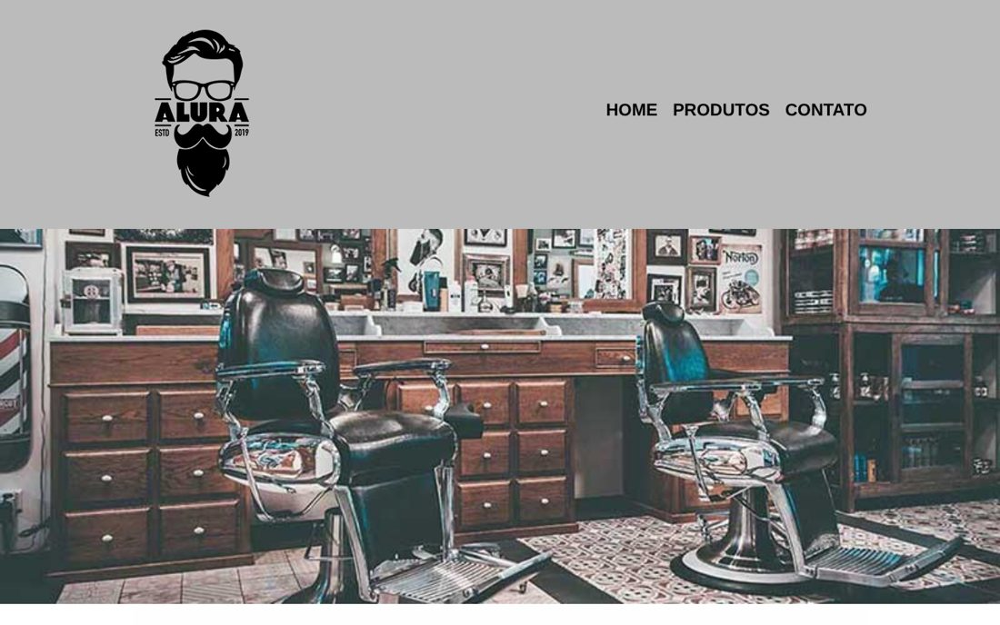

# Barbearia Alura

[](https://github.com/almircs/Barbearia/actions/workflows/ci.yml)

Site institucional de uma barbearia, com três páginas: apresentação, serviços com preços e contato. Projeto da formação de HTML e CSS da Alura, adaptado para celular.

**[▶ Ver o site](https://almircs.github.io/Barbearia/)**



## Páginas

- **Home**: sobre a barbearia, mapa com a localização, benefícios e vídeo
- **Produtos**: serviços de cabelo, barba e pacote completo com preços
- **Contato**: formulário com validação nativa do HTML e tabela de horários

## O que pratiquei

- HTML semântico (`header`, `nav`, `main`, `section`, `footer`)
- Formulários: `label`, `fieldset`, campos `email` e `tel`, `select`, `radio` e `checkbox`
- Tabelas, `iframe` (Google Maps e YouTube)
- CSS com reset, fontes do Google Fonts e media queries para celular

## Rodar localmente

```bash
git clone https://github.com/almircs/Barbearia.git
```

Depois é só abrir o `index.html` no navegador.

## Licença

[MIT](LICENSE)
